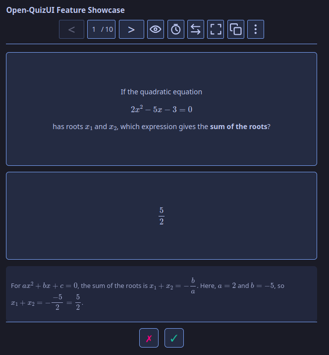
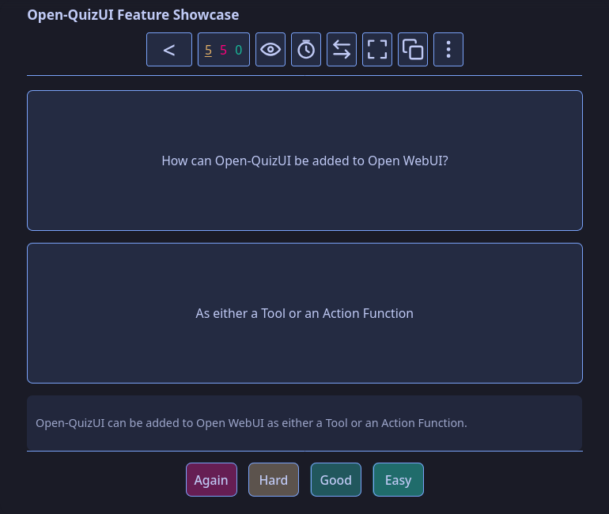
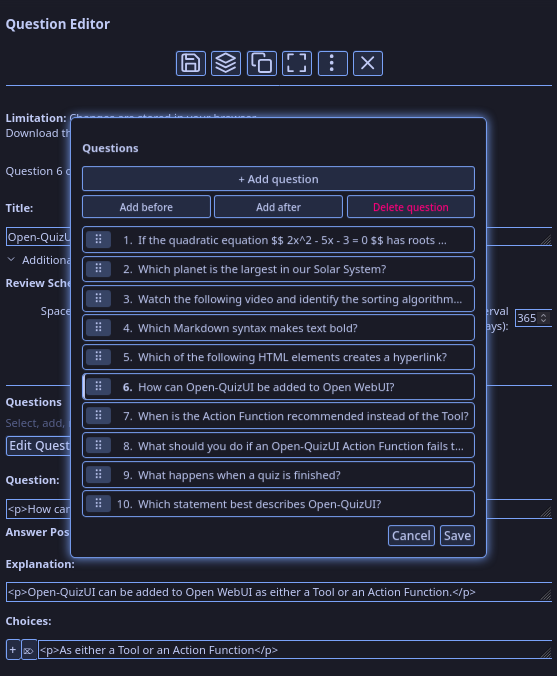

# Release Notes

## 3.0

### Introducing Open QuizUI 3.0

Open QuizUI allows models to create **powerful interactive quizzes** inside Open WebUI. 3.0 is the biggest update since the project started: **flashcards** are now supported, **spaced repetition (FSRS)** is built in, and **questions** can be full **edited, reordered, added or deleted** without leaving the editor.

---

Open QuizUI 2.0 was released a month ago. Bug fixes and minor improvements came soon after in 2.1 and 2.2. It was already pretty great for multiple choice questions. But, as I received **feedback**, got my **Reddit account shadowbanned**, and continued using it for **hundreds of questions**, I kept on updating it. Now, it’s time to release the new and improved version out of the development branch!

This release hopefully fixes all your previous issues with the original plugin. As teased above, it also adds a ton of new functionality that makes it a lot better than the quiz interfaces used by ChatGPT and Gemini/NotebookLM. Let me know if you encounter bugs or need a missing feature, and consider helping out on the GitHub, as I do this all for free.

### New features

#### Flashcard mode

Open QuizUI is **no longer limited** to multiple choice and truth/false questions! It now features a flashcard mode, which, intelligently, can be toggled on even after generating a multiple choice quiz.

- Rate the card **✗** (unknown) or **✓** (known) with the buttons or keys / tap zones. Ratings are recorded and appear in the results.
- Action Function: a message of questions + answers (Markdown table, or question labels with the answer beneath) is now read as flashcards and rendered as reveal-and-rate cards. The tool also has a toggle in the settings. Entirely optional: you can turn of the flashcard parser in the options. If you experience any bugs with it, please let me know here or on GitHub.

#### Spaced repetition (FSRS)

Ever took a quiz and had a few questions which you got wrong, and wished for a way to retake it later? Well, take a look at the new spaced repetition mode!

- **Toggle Repetition** in the **⋮** menu switches a quiz to FSRS review and back, and the choice is remembered.
- Configurable FSRS scheduling for both MCQ and flashcard modes, with a four-point rating (Again / Hard / Good / Easy).
- Default configuration: Rating a question “Easy” when it first shows up will prevent it from coming up again, just like you’re used to. If you want a question to come up again as you’re struggling on it, click on the “Again” rating!

#### Upgraded Question editor

Previously, anything more complicated than a quick edit meant copying the quiz into plain text and editing it manually. Well, those days are over! (Unless you're like me, creating 256-question quizzes, in which case . . . some surgery will be needed.)

- **Add, delete, reorder, and navigate** with the new "Edit Questions" list under “Additional Settings” in the Question Editor.
- Reorder with **style**: effortlessly **drag** questions where you want them to be; changes are **colour coded**, and as usual everything depends on your chosen colour scheme!
- Tested for **touch devices** (Android and iOS).

#### Improvements to Copy / download

Both support everything mentioned above!

- Copy Quiz and Copy Question intelligently determine if you are copying flashcards or multiple-choice-questions; new **Copy as Flashcards** for those of you who which to extract flashcards from a multiple choice quiz (copies as a Markdown table, which you could import in Anki or other programs).
- Download HTML saves the question order and SRS state configuration.

#### Results / UI

No more squinting your eyes to find which questions you missed!

- Results reworked: each question is **colour coded** depending on how you answered it.
- Rating indicator in the page corner after each rating (✗ / ✓ / ✓✓, in the button's colour).
- There were **so many buttons**, I had to add “More” **dropdown menus** per page.
- Full-screen improvements : entirely remove the title row from full-screen to avoid distractions!
- Hover over any new button to see what it does!

#### Better Documentation

I added multiple new explanations in the docs. If you have any questions, changes are your answer is somewhere in there!

Worth mentioning: if you use iOS or iPadOS and want to do quizzes outside Open WebUI, entirely offline, than I finally found a good solution! See TODO.

#### Better remembered across a refresh

Your mode, review state and settings are saved per quiz and restored when the page reloads.

### Bug fixes

Most bug fixes were entirely in the scope of the dev branch, as release was already stable as off 2.2.1.

### Under the hood

The **test suite grew a lot**, including a headless-browser end-to-end test of the page Open WebUI actually serves, and CI runs both suites through npm.

The repo now includes an AGENTS.md to speed up development.

Take a look at the list of issues on GitHub or add new ones; feedback and contributions would be much appreciated.

### Upgrading / Installing

Replace both functions with the files from this release:

- **Admin Panel → Functions**, re-import [`release/action_function.py`](https://github.com/axel-chamberland/Open-QuizUI/blob/main/release/action_function.py)
- **Workspace → Tools**, re-import [`release/tool.py`](https://github.com/axel-chamberland/Open-QuizUI/blob/main/release/tool.py)
- Bookmark and upvote the [tool](https://openwebui.com/posts/open_quizui_interactive_quiz_generator_tool_afcbe686) and the [action function](https://openwebui.com/posts/open_quizui_interactive_quiz_generator_58a378ef) to be updated on new releases and bug fixes.

Your existing valves are kept, and the new ones (**Parse mode**, **Flashcard format**, **Enable spaced repetition**, etc.) default to the previous behaviour.
